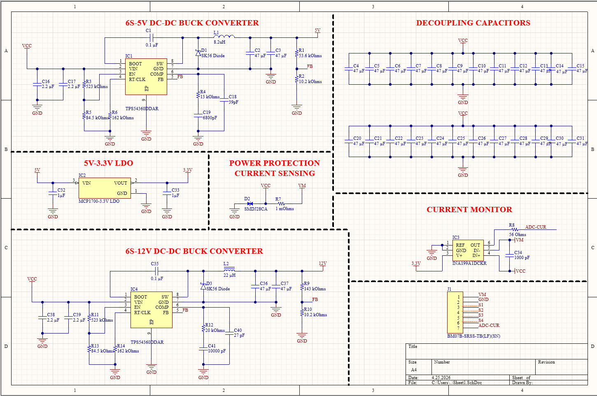
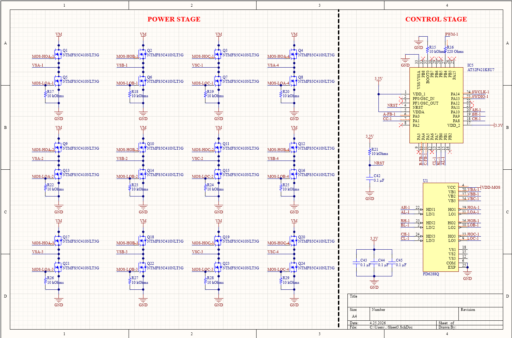

[Türkçe](README.md) | **English**

# 4-in-1 ESC Board with Integrated Power Distribution and Current Sensing

This project develops a 4-in-1 Electronic Speed Controller (ESC) board for UAVs, capable of controlling four BLDC motors while combining power distribution, voltage regulation, and current sensing on a single board.

The project is supported by the TÜBİTAK 2209-A Research Projects Support Program for Undergraduate Students.

## Project Report

The detailed report prepared for TÜBİTAK 2209-A is available below.

[View the PDF report](mert_uzun_insansiz_hava_araclarinda_entegre_guc_dagitimi_ve_akim_olcumu_ozellikli_4in1_elektronik_hiz_kontrolcu_karti.pdf)

## Project Information

| Item | Details |
|---|---|
| Project lead | Mert Uzun |
| Academic advisor | Prof. Dr. Bahattin Türetken |
| University | Kocaeli University |
| Department | Electronics and Communications Engineering |
| Funding program | TÜBİTAK 2209-A |
| Project status | Design and development in progress |

## Project Goal

Conventional UAV power systems use multiple independent electronic modules for motor control, voltage regulation, power distribution, and current sensing. This arrangement can increase cabling, system weight, and the risk of connection-related faults.

The project aims to combine these functions on a single PCB. The board is intended to provide:

- Independent and simultaneous control of four BLDC motors
- Distribution of 6S LiPo battery power to the motor driver stages
- Regulated 5 V and 12 V outputs for system components
- Measurement of total power-line current through a shunt resistor
- An analog current output to the flight controller
- Reduced need for external power modules and additional wiring

## System Architecture

The board consists of four main sections:

1. **Motor driver stages:** Independent three-phase MOSFET bridges for four BLDC motors
2. **Control unit:** A microcontroller and gate driver circuits that manage motor drive signals
3. **Power regulation:** Regulator circuits producing 5 V, 12 V, and 3.3 V rails
4. **Current sensing:** Total current measurement using a shunt resistor and a current-sense amplifier

## Technical Specifications

| Feature | Target or description |
|---|---|
| Number of motors | 4 BLDC motors |
| Battery | 6S LiPo |
| Nominal / fully charged battery voltage | 22.2 V / 25.2 V |
| Continuous current target per motor | 40 A; to be verified by load and thermal testing |
| PCB target | 4 layers |
| Motor driver topology | Three-phase MOSFET bridge |
| Regulated outputs | 5 V and 12 V |
| Control voltage | 3.3 V |
| Current measurement method | Shunt-based sensing |
| Current measurement target | Maximum ±5% error |
| Flight controller interface | Analog current measurement output |
| Protection | Power-line transient voltage protection |

## Main Components

| Component | Part number | Role |
|---|---|---|
| Microcontroller | AT32F421K8U7 | Motor control and system management |
| Gate driver | FD6288Q | Driving MOSFET switching signals |
| Power MOSFET | NTMFS5C410NLT3G | Switching BLDC motor phases |
| DC-DC converter | TPS54360DDAR | Generating regulated supply voltages |
| LDO regulator | MCP1700-3.3V | Generating the 3.3 V control rail |
| Current-sense amplifier | INA199A1DCKR | Amplifying the shunt voltage |
| Shunt resistor | CS25FTER100 | Sensing total system current |
| TVS diode | SMDJ28CA | Protection against transient voltage spikes |

## Design Targets

- Integrate power distribution, motor control, and current sensing on one board
- Develop compact hardware capable of controlling four BLDC motors simultaneously
- Build a power architecture compatible with 6S LiPo battery systems
- Integrate 5 V and 12 V regulator circuits into the ESC board
- Measure total system current with a target error of ±5%
- Send the measured current information to the flight controller
- Reduce cabling, connection count, and total system weight
- Validate performance through laboratory and field tests

## Schematic Design

### Power Regulation and Current Sensing

The schematic below shows the battery input, voltage regulation stages, shunt-based current sensing, and protection components.

### Motor Control and Power Stages

The schematic below shows the microcontroller, gate driver circuits, and three-phase MOSFET motor driver stages.

## Project Status

Preliminary schematics were prepared in Altium Designer; design and development work is ongoing. The 40 A per motor and ±5% current measurement figures are design targets, not measured results from a manufactured board.

- [x] Define system requirements
- [x] Establish circuit architecture
- [x] Select main components
- [x] Design power regulation circuits
- [x] Design current measurement circuits
- [x] Prepare motor driver circuits
- [ ] Complete PCB design
- [ ] Manufacture and assemble the board
- [ ] Test power stages
- [ ] Test motor driving
- [ ] Calibrate current measurements
- [ ] Conduct field tests

## Planned Tests

The following tests are planned to validate the design:

- Measure the 5 V and 12 V outputs under load
- Examine regulator output ripple
- Compare the current sensing circuit with a reference instrument
- Test simultaneous operation of four motors
- Monitor MOSFET and regulator temperatures under different loads
- Examine the behavior of power-line protection components
- Verify current information sent to the flight controller

## My Contribution

As project lead, I work on requirements, system architecture, component selection, and preliminary schematics. My focus is integrating motor control, auxiliary power regulation, and current sensing into a common board architecture.

## Published Files

This repository contains schematic images and the TÜBİTAK project report. Editable Altium sources, a completed PCB, manufacturing files, and motor control firmware are not published in the current repository.

[My other engineering projects](https://github.com/mertuzun41/Projeler/blob/main/README.en.md)

## Contact

**Mert Uzun**  
Kocaeli University  
Electronics and Communications Engineering

[LinkedIn profile](https://www.linkedin.com/in/mert-uzun-b74459308)
